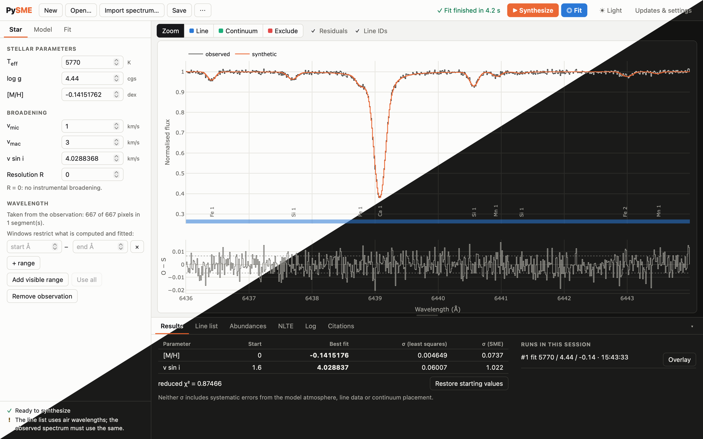

# PySME-GUI

A desktop interface for [PySME](https://github.com/SpectroscopyMadeEasy/PySME):
set up a star, synthesize a spectrum, compare it with an observation, edit the
mask, and fit stellar parameters or abundances.

**This is an alpha version** for internal testing (see
[RELEASING.md](RELEASING.md)). The interface says so beside its name, *alpha* or
*beta*, taken from the version number; a final release shows nothing there.



*The solar example fitted to a simulated observation (upper left: light mode,
lower right: dark mode).*

## Install

### macOS (Apple Silicon, macOS 15 or newer)

1. Open `PySME-<version>-arm64.dmg`.
2. Drag **PySME** onto **Applications**.
3. Open PySME. The first launch downloads Python, PySME and their dependencies
   (needs a network connection and about 900 MB of disk). Later launches start
   in a few seconds.

You do not need Python, conda or Node installed.

The app is not signed with an Apple Developer ID. A disk image built on your own
Mac opens normally. One that was **downloaded** is blocked by Gatekeeper: after
the first attempt, open *System Settings → Privacy & Security* and choose
*Open Anyway*.

### Linux (x86_64)

Download the source archive (`Source code (tar.gz)`) of a release from the
repository's *Releases* page, or clone the repository. In the unpacked folder run

```bash
linux/install.sh
```

It needs `curl`, no administrator rights, and a network connection to fetch
Python and PySME. It adds a `pysme-gui` command and a menu entry; the downloaded
folder can be deleted afterwards (keep it, or download again, to uninstall with
`linux/install.sh --uninstall`).

The interface opens in your web browser. To quit, choose *⋯ → Quit PySME*.
Closing the tab leaves it running with everything in it, and starting PySME
again shows it. What it prints when started from the menu is kept in
`~/.local/share/pysme-gui/pysme-gui.log`.

### Windows (64-bit, x86)

**New and little tried:** so far it has run only on GitHub's Windows machines.

1. Download the source archive (`Source code (zip)`) of a release from the
   repository's *Releases* page.
2. **Extract the whole zip file** (right-click, *Extract All…*).
3. In the extracted folder, open `windows` and double-click
   **Install PySME.cmd**. If Windows shows *Windows protected your PC*, choose
   *More info → Run anyway*; the scripts are not signed.

It needs no administrator rights. It needs a network connection that reaches
github.com: Python's installer and PySME for Windows are downloaded from there,
the other packages from PyPI. It puts a **PySME** shortcut on the desktop and in
the Start menu; the downloaded folder can be deleted afterwards (keep it, or
download again, to remove PySME with `windows\Uninstall PySME.cmd`).

The interface opens in your web browser. To quit, choose *⋯ → Quit PySME*.
Closing the tab leaves it running with everything in it, and starting PySME
again shows it. What it prints is kept in
`%LOCALAPPDATA%\PySME-GUI\pysme-gui.log`. To repair an installation, run
`install.ps1 -Repair` (in PowerShell:
`powershell -ExecutionPolicy Bypass -File "windows\install.ps1" -Repair`).

Linux has not been tried on a real computer yet. Intel Macs and Windows on ARM
are not supported because PySME publishes no binary packages for them.

## Using it

- **Try it:** press *Try the solar example*, then *Synthesize*. The first use of
  a model atmosphere grid downloads it to `~/.sme`.
- **Your own star:** load a VALD line list (extract stellar or extract all), set
  the parameters and a wavelength range, press *Synthesize*.
- **Observations:** *Import spectrum…* reads text or CSV files: `wave flux`,
  `wave flux error`, `wave flux error mask`, or `segment wave flux [error]`. A
  header row with column names overrides the guess. Wavelengths are in Å and
  must be in the same medium (air or vacuum) as the line list.
- **Mask:** choose *Line mask*, *Continuum mask*, *Velocity mask* or *Remove mask*
  above the plot and drag across pixels; click the button again to go back to
  zooming. The arrow next to *Remove mask* chooses whether it takes off all masks
  or only one kind. As in PySME, a pixel can carry several masks; the strip under
  the spectrum is then divided, line on top, continuum, velocity. Pixels with the
  line mask are the ones fitted. Without a mask, pixels are not used.
- **Radial velocity:** its value is on the *Star* tab, and *v_rad* on the *Fit* tab
  makes it a free parameter (one for all segments, or one each). *Synthesize* uses
  the value shown; *Fit* finds it. PySME finds it apart from the other parameters
  and gives no uncertainty. The velocity mask appears while *v_rad* is free. Until
  you change it, it is the line mask, which is what PySME uses when no pixel is
  marked for the velocity; once any is, only those count. PySME searches within
  ±500 km/s, so with only a few weak lines marked it can match them to other lines:
  check the result against the plot.
- **Size:** ⌘+ and ⌘− scale the whole interface and ⌘0 restores it (in a web
  browser, use the browser's own zoom).
- **Line data:** the *ref* link of a line shows everything the list holds on it,
  each value beside its source, and those references only. For a long-format
  VALD list the source of each quantity follows from VALD's fixed order.
- **Fit:** pick free parameters in the *Fit* tab, or mark abundances in the
  periodic table, then press *Fit*.
- **Abundances and NLTE:** in the periodic table under *Abundances*, the **N** in
  the corner of an element turns NLTE on for it (outlined where a grid exists,
  filled when on; the grid is chosen on the right). Point at an element to get the
  dot that makes its abundance a free parameter.
- **[X/Fe]:** switch the table from A(X) to [X/Fe] to read and type abundances
  relative to the *Solar reference*; the Fe box then holds [Fe/H], and H and He
  stay A(X). Typing changes that element only, so a new Fe moves the others'
  [X/Fe]. Choosing another reference changes no abundance. Fit results list [X/Fe]
  too. Its errors are PySME's own for that element, without those of Fe or of the
  solar values; none are given when Fe was fitted as well.
- **Abundance pattern:** the switch above the plot shows A(X) or [X/Fe] against
  atomic number, with error bars from the last fit while its values are unchanged.
  Click a point to select that element in the table.
- **Light or dark:** the button at the top right (*View → Appearance* on macOS)
  matches the system, or stays light or dark. The choice is remembered, and
  exported PNG figures are always light.
- **Files:** *Save* writes a normal PySME `.sme` file that scripts can load.
  IDL `.inp` / `.sav` files can be opened. Double-clicking an `.sme` file opens
  it in the app.

Things worth knowing when reading results:

- If a setting changes after a synthesis, the plotted model is drawn dotted and
  marked *out of date*.
- If the observation has no error column, a signal-to-noise ratio is assumed.
  χ² and the parameter errors scale with it.
- PySME solves abundances on the *pattern* scale, which excludes [M/H]. The
  results table shows A(X) as used in the synthesis and prints the solver's own
  number underneath. When [M/H] is free too, no error is quoted for A(X).
- Two uncertainties are shown (least-squares covariance and PySME's SME
  estimate). Neither includes model, line-data or continuum systematics.

## Updates and PySME versions

The interface and PySME are versioned and updated separately, in *Updates &
settings*. Updates are checked quietly at start-up; nothing is installed or
switched on its own. A dot marks the button when something newer is available,
when an installation or update has finished and you have not looked yet, and
while a change waits for a restart.

**Interface.** *Update interface* installs the newest release tag in your update
channel (release only, which is the default, or release + beta) and checks that it starts with
your current PySME; your PySME version is not changed. If the new interface does not support that version, it says so and
changes nothing. *Go back to …* undoes it; the button is shown only when the
interface used before is an older one.

**PySME.** Several versions can be installed side by side. *Install* adds one
from PyPI (on Windows, from PySME's releases on GitHub) without switching to it; *Use* switches (after a restart); *Remove*
deletes one that is not in use. Only releases with a ready-made package for your
computer are listed, pre-releases only on request. This interface supports the
range given by `PYSME_MINIMUM` and `PYSME_BELOW`, and new users get
`PYSME_RECOMMENDED`.

**Reproducing a setup.** Each installation records the exact version of every
package. *Help → Reinstall PySME…* rebuilds the one in use from that list.
For large runs, either use the Python shown under the version list (scripts then
get the same installation as the app), or save the *Package list…* and install it
elsewhere with Python 3.12:

```bash
pip install --only-binary pysme-astro -r pysme-1.3.0rc2-packages.txt
```

Builds differ between systems, so results need not agree bit for bit. Model
atmospheres and NLTE grids in `~/.sme` are shared by all versions and are not
part of the list. Exported CSV files and saved `.sme` files record the PySME,
SMElib and interface versions that computed the spectrum (in CSV files as a
first line starting with `#`; with pandas use `read_csv(..., comment="#")`).

The native window itself (the Swift part, including the setup screen) only
changes when you install a newer disk image. That also brings the interface in
it, and keeps your PySME version if supported.

**Use your own PySME (advanced).** Most people leave this empty. Under
*Updates & settings → Advanced* the interface can run with an installation of
yours, such as a development build or one you compiled. To find the path,
activate the environment in which you use PySME and run

```bash
python -c "import sys; print(sys.executable)"
```

then paste the line it prints. Your environment needs PySME only; the interface
comes with the app. Before the path is saved, the app checks that the interface
starts with it; a PySME outside the supported range is used only if you confirm.
It takes effect after a restart. Version management is off meanwhile; *Go back to
the app's own PySME* undoes it.

## Reporting a problem

*Report a problem…* (in *Updates & settings*, the ⋯ menu, the *Help* menu on
macOS, and next to error messages) writes one text file with the program
versions, system information and recent log. You read and can edit it before it
is saved to *Downloads*; then you attach it to a GitHub issue (public; needs a GitHub account, and issues must be enabled in
`ISSUE_REPO`). Nothing is sent automatically. Spectra and line lists are never included; stellar
parameters and fit values only if you tick the box. User names in paths are
removed, but file and star names in the log may remain, so check the text.

If you cannot use GitHub, give the file to the person who gave you the program.
The program holds no e-mail address and sends nothing itself. If setup fails or
PySME does not start, the macOS error message has the same button and writes a
shorter report.

## Where things live

| What | Where |
|---|---|
| App environment, logs, settings | `~/Library/Application Support/PySME-GUI` (macOS), `~/.local/share/pysme-gui` (Linux), `%LOCALAPPDATA%\PySME-GUI` (Windows) |
| Model atmospheres, NLTE grids | `~/.sme`, shared with other PySME installations |

To uninstall on macOS, delete the app and the first folder. `~/.sme` is yours.
If something is broken, use *Help → Reinstall PySME…*.

## Development

The GUI is a small local web server (`pysme_gui/server.py`) that holds a real
`SME_Structure`; PySME runs in a child process (`worker.py`) so runs can be
stopped and a crash does not close the window. The interface is plain HTML and
JavaScript in `pysme_gui/static/`. On macOS, `macos/PySMEApp.swift` shows it in a
native window.

```bash
python -m pysme_gui                 # in any environment with pysme-astro
python -m pytest tests              # runs real PySME; downloads MARCS once
macos/build.sh                      # dist/PySME.app and the disk image
```

The server listens on 127.0.0.1 only, requires a random per-session token, and
checks the `Host` header. It does not open NumPy pickle files (`.npy`, `.npz`).

To check the packaged app without clicking through it, start the binary with
`PYSME_GUI_SELFTEST=<folder>`: it runs the solar example in the real window,
writes `report.json` and `window.png` there, and quits. Add
`PYSME_GUI_HOME=<empty folder>` to include the first-launch setup.

**Releasing.** Version stages, update channels and the steps for a release are
in [RELEASING.md](RELEASING.md).

This interface (0.3 and later) replaces the earlier Electron program, which
remains in the history of `master`. The example line list `pysme_gui/examples/sun.lin` is the VALD
extract from the PySME examples.
